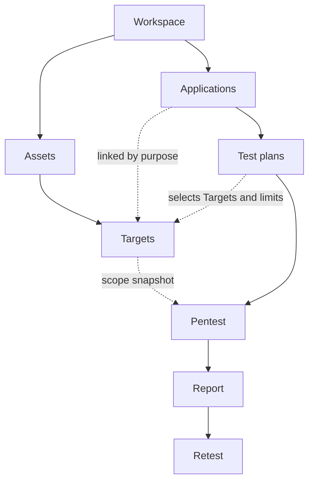

RedRound separates **what you own** (Assets and Targets) from **what you want tested** (Applications). A pentest always covers one Application and only the Targets you select for it.

## Objects

| Object | What it is |
| --- | --- |
| **Workspace** | Where your data, members, billing, and pentest credits live. |
| **Asset** | A group of Targets that share a host. `example.com` and `www.example.com` share one Asset; each other subdomain is its own Asset. An Asset is not a physical server. |
| **Target** | A specific domain or URL you registered, such as `example.com` or `https://api.example.com/v1/`. Every Target belongs to one Asset. |
| **Application** | A product or system that serves one business purpose, such as your store or your customer portal. You link the Targets it uses. |
| **Test plan** | The reusable scope and parameters for one Application: which linked Targets, which paths, and which exclusions. |
| **Test scope** | What one pentest is allowed to cover: the selected Targets, their domains and URLs, paths, exclusions, business notes, and your authorization. |
| **Pentest** | One accepted and delivered test of one Application. It keeps a snapshot of the scope at acceptance. |
| **Report** | The deliverable of one Pentest, as a web page and a PDF. Revisions create new versions. |
| **Retest** | A check of whether findings in an existing report were fixed. A standard full report includes two Retest rounds. |

## How they relate

- One Asset can have many Targets. A Target belongs to one Asset.
- An Application can use Targets from several Assets, and one Target can serve several Applications. Sharing a Target does not merge two Applications into one pentest.
- A Test plan belongs to one Application and can only select Targets linked to it.
- A Pentest keeps the scope it was accepted with. Later changes to Assets, Targets, or Applications do not change accepted pentests or published reports.

## What grouping does not do

Grouping Targets under an Asset helps you organize them. It does not:

- Verify ownership of the other domains in the Asset.
- Add other Targets in the Asset to an Application or a pentest.
- Authorize testing of paths, ports, or subdomains you did not select.

<Note>
  RedRound tests only the Targets you select, for the Application you choose, inside the conditions you set. Domain ownership is checked again before every pentest is accepted.
</Note>
