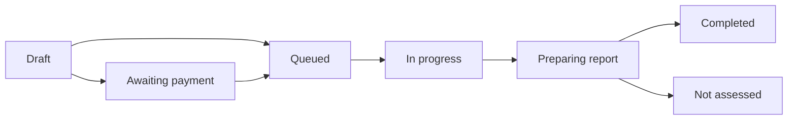

A pentest moves from a draft you edit, through acceptance and testing, to a published report. The status shown in **Pentests** reflects confirmed facts only: a request you sent, such as a pause, does not change the status until RedRound confirms it.

## Status reference

| Status | Meaning | What you can do |
| --- | --- | --- |
| **Draft** | Scope not submitted yet. Saving a draft is free and uses no credit. | Edit the Application, Targets, and parameters; submit. |
| **Awaiting payment** | The scope check passed for a Single report purchase, and payment has not succeeded yet. | The owner continues to payment or cancels. |
| **Queued** | Accepted. The scope is frozen and a credit or payment is reserved. | View scope and estimated delivery; the owner can cancel. |
| **In progress** | Testing has started. | The owner can request a pause or a stop. |
| **Paused** | A pause took effect. | The owner can request to resume the same scope or stop. |
| **Action required** | RedRound needs information from you before testing can continue. | Reply with the requested details before the deadline. |
| **Preparing report** | Testing ended. The report is being reviewed. | Wait for publication. |
| **Completed** | The report is published. It may show full or partial coverage. | Read the report, unlock it if needed, request a Retest. |
| **Not assessed** | Testing ended and none of the agreed scope could be covered. A report explains why. | Read the explanation; check whether [compensation](#compensation) applies. |
| **Rejected** | RedRound declined the pentest before testing started. | Read the reason, fix it, and submit again. The reservation is released. |
| **Canceled** | Canceled before testing started. | Submit again when ready. |
| **Stopped** | Stopped after testing started. | View any partial report. The credit or payment is used. |
| **Failed** | RedRound ended the pentest for a platform reason and could not produce a report. | Read the notice; [compensation](#compensation) applies. |

A discarded draft appears as **Discarded draft** under the Drafts filter. It was never accepted and is not counted as a pentest.

## Typical path

Not every pentest passes through **Awaiting payment**. It appears only for a Single report purchase. Pentests that use a free or plan credit go straight from **Draft** to **Queued**.

## Action required

When RedRound needs something from you, such as a working test account or a corrected scope detail, the pentest shows **Action required** with the missing items and a reply deadline. For a full pentest, the deadline is 7 days after the status starts. Reply from the pentest page. If the deadline passes, RedRound may cancel or stop the pentest, and the status changes only after that is confirmed.

## Coverage

Each published report states coverage for every selected Target:

- **Complete**: every selected Target was covered.
- **Partial**: at least one Target was covered, and at least one was partly or not covered. The status reads **Completed · Partial coverage**.
- **Not assessed**: no Target could be covered.

A Target that was covered and had no findings counts as covered.

## Compensation

If a platform reason caused partial coverage, a not-assessed result, or a failed pentest, the owner or a member can request compensation for the original pentest:

- One compensation per original pentest.
- Request it within 14 days of the report's first publication, or within 14 days of the failure notice if there is no report.
- Compensation covers the same Application and no more than the original scope. It is valid for 30 days after approval.

## Estimated delivery

After acceptance, the pentest shows an estimated delivery time. If it is not yet known, the page shows that delivery time is being confirmed. Delays are labeled **Delivery delayed**.
